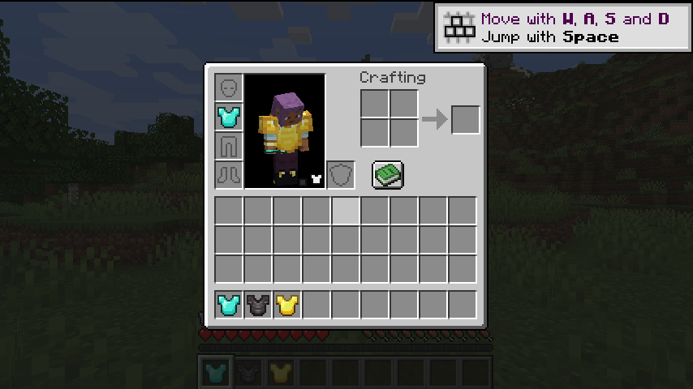
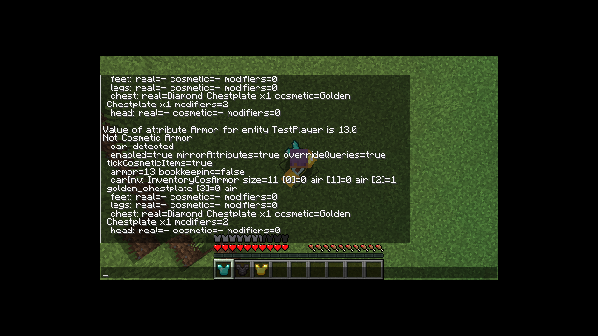
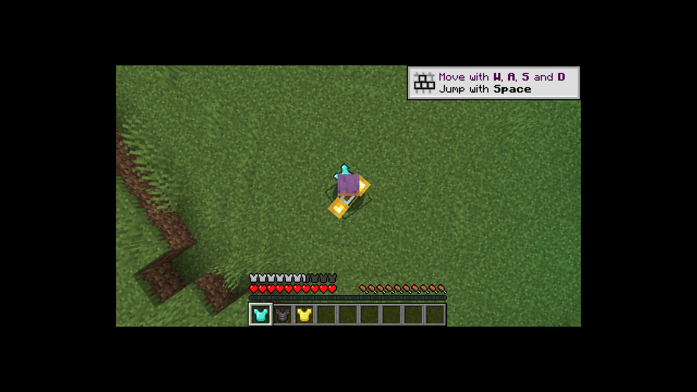
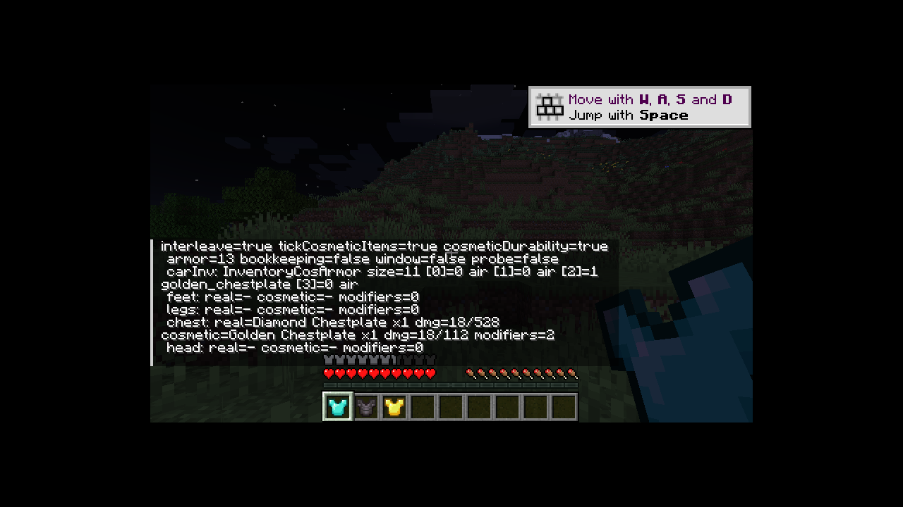

# Not Cosmetic Armor

Cosmetic Armor Reworked のコスメ装備を、**見た目だけ**から**実際に機能する装備**に変える 1.20.1 Forge 用アドオンです。

コスメ枠に防具を入れると、その防具の防御力・防具強度・ノックバック耐性などの属性と、
Protection / Thorns / Frost Walker などのエンチャントが有効になります。
実装備（本物の防具枠）はそのまま「本物」として動き続けます。

## 動作環境

| 項目 | バージョン |
|---|---|
| Minecraft | 1.20.1 |
| Forge | 47.x（開発・検証は 47.4.28） |
| Java | 17 |
| 必須 | [Cosmetic Armor Reworked](https://www.curseforge.com/minecraft/mc-mods/cosmetic-armor-reworked) 4.x（1.20.1-v1a で検証） |

CAR は必須依存です（`mods.toml` で `mandatory=true`）。CAR が無い場合は Forge が
「Missing or unsupported mandatory dependencies」として起動を止めます。

## 何が機能するか

- **属性**: コスメ防具の attribute modifier（防御力、防具強度、ノックバック耐性、移動速度など）を実装備の上に加算。UUID はプレイヤー・スロットごとに再生成するので、実装備の modifier と衝突しません。
- **エンチャント**: `Player#getItemBySlot` と `Player#getArmorSlots` の両方を上書きしてコスメ装備を「着ている防具」として返すため、バニラのダメージ軽減（Protection / Feather Falling / Thorns）や他 MOD の参照にもコスメ防具が見えます。バニラの軽減計算は `getItemBySlot` ではなく `getArmorSlots` のリストを回すため、片方だけでは効きません。
  同じスロットの実装備のエンチャントとも**合算**されます（属性ミラーと同じ「両方足す」方針）。バニラの軽減は EPF の合計が 20 で頭打ちなので、二重に Protection IV を積んでも上限を超えません。
- **tick 内の参照（インタリーブ）**: 奇数ゲーム tick の `Player#tick` の間だけ、コスメ装備を実装備枠に**コピー**して入れ、tick の終わりに元へ戻します。鞘翅の滑翔判定、カメの甲羅の水中呼吸、MOD の「この装備を着ているか」判定など、tick の内側で `getItemBySlot` を読む処理にもコスメ装備が見えます。クライアントには何も送られず、実装備は一切失われません。
- **item tick**: コスメ枠のアイテムにも `inventoryTick` / Forge の `onArmorTick` が走ります。エネルギーやチャージを持つ MOD 防具（TiC など）の動作に必要です。
- **耐久**: 実装備が耐久ダメージを受けたとき、同じスロットのコスメ装備にも**同じ量**のダメージが入ります（4 分の 1 丸め・最低 1 のバニラ規則、Unbreaking、壊れたら消える挙動まで同じ）。`/notcosmeticarmor status` の `dmg=` で両方の耐久値を確認できます。

## 何が機能しないか（意図的）

- **描画**: 見た目の差し替えは従来どおり CAR が担当します。本 MOD は描画コードに触りません（[描画（L4）](#描画l4)）。
- **実装備の tick**: コスメの下に隠れている実装備も、これまで通り tick されます（バニラの挙動を変えない方針）。
- **軽減の上限**: ダメージ軽減エンチャントはバニラの規則どおり EPF 合計 20（最大 80%）で頭打ちです。実装備とコスメで積んでも上限は変わりません。
- **ピグリン**: `PiglinAi` が金防具を `getArmorSlots` で判定するため、コスメの金防具でもピグリンが敵対しなくなります（バニラの判定と同じ経路に乗るため、意図的に残しています）。

## 設定

`config/notcosmeticarmor-server.toml`（サーバー側）:

| キー | 既定 | 説明 |
|---|---|---|
| `general.enabled` | true | MOD 全体の有効/無効 |
| `behavior.mirrorAttributes` | true | コスメ防具の属性を実装備に加算する |
| `behavior.overrideQueries` | true | `getItemBySlot` / `getArmorSlots` でコスメ防具を返す（エンチャント有効化） |
| `behavior.interleave` | true | 奇数 tick の間だけコスメ装備を実装備枠にコピーする（tick 内参照の有効化） |
| `behavior.tickCosmeticItems` | true | コスメ枠のアイテムを tick する |
| `behavior.cosmeticDurability` | true | 実装備が受けた耐久ダメージをコスメ装備にも同じ量だけ入れる |
| `behavior.ignoreSkinArmorFlag` | true | CAR の「skin armor」フラグが立ったスロットも機能させる |

## コマンド

```
/notcosmeticarmor status   # 状態表示
/notcosmeticarmor probe    # tick 窓の内外で getItemBySlot が何を返すかをログに出す（デバッグ）
```

権限レベル 2 以上。`status` は CAR の検出状況、実効モード（OFF / ATTRIBUTE / PRIORITY / INTERLEAVE）、
設定値、各スロットの実装備/コスメ装備、適用中の modifier 数、現在の防御力、差分ガードと tick 窓の
状態を表示します。`probe` を有効にすると、数秒おきに次のようなログが出ます:

```
probe(inside window): chest seen=1 golden_chestplate storedReal=1 diamond_chestplate armorValue=13
probe(outside window): chest seen=1 diamond_chestplate armorValue=13
```

## ビルド

Nix を使う場合（JDK 17 とクライアント実行用ライブラリが揃います）:

```sh
nix develop
./gradlew build
# => build/libs/notcosmeticarmor-1.20.1-<version>.jar
```

Nix を使わない場合は JDK 17 を用意して `./gradlew build` を実行してください
（Gradle 8.8 は wrapper が取得します）。

開発用クライアント:

```sh
./gradlew runClient
```

CAR は CurseMaven 経由の依存として `build.gradle` に入っているので、`runClient` でも
そのまま読み込まれます（`fg.deobf` が SRG 名の配布 jar を開発用の名前に変換します）。
`run/mods/` に CAR の配布 jar を直接置かないでください。SRG 名のままでは開発ランタイムで
`Component.m_237113_` が見つからず、起動時に `NoSuchMethodError` で落ちます。

```groovy
implementation fg.deobf('curse.maven:cosmetic-armor-reworked-237307:4600191')
```

バージョンを変えるときは CurseForge のファイル ID（末尾の数字）を差し替えてください。

`compileJava` は Gradle のビルドキャッシュを使わない設定にしてあります。mixin の refmap は
アノテーションプロセッサが `build/tmp` に書き出すため、キャッシュから復元されると jar に
入らないことがあるからです。refmap が無いと本番で `No refMap loaded` になり全 mixin が
失敗します。`jar` タスクは refmap の同梱を検証し、無ければビルドを失敗させます。

## 仕組み

1. **属性ミラー** — 毎 tick、コスメ枠の `getAttributeModifiers` を読み、UUID を再生成した
   transient modifier として `AttributeMap` に追加/削除する。クエリ上書きとは独立に動く。
2. **クエリ上書き** — `Player#getItemBySlot` の RETURN で、防具スロットかつサーバー側のときだけ
   コスメスタックを返す。`Player#getArmorSlots`（`m_6168_`。バニラのダメージ軽減が回すリスト）も
   同じ条件で、実装備リストをコピーしてコスメに差し替えたリストを返す。実体（`Inventory#armor`）は
   一切書き換えない。
3. **差分ガード** — バニラは `LivingEntity#tick` の中で毎 tick 装備の差分を取り、
   変化があれば属性を付け替えて `ClientboundSetEquipmentPacket` を送る。その差分処理の間だけ
   上書きを止め、バニラには常に実装備を見せる。これがないと毎 tick パケットが飛び、属性が壊れる。
4. **tick 窓（インタリーブ）** — 奇数 tick の `Player#tick` の間だけ、コスメの**コピー**を
   `Inventory#armor` に入れて実装備を退避する。窓の中ではバニラの装備差分処理自体を
   `detectEquipmentUpdates` の HEAD でキャンセルするので、属性の二重計上もパケット送信も起きない。
   窓は tick の終わり（例外時は次 tick の頭）に必ず閉じ、実装備を書き戻す。
   コピーを入れているので、`Inventory#armor` を直接書き換える他 MOD は窓の中ではコピーを見る。
5. **耐久ミラー** — 実装備が耐久ダメージを受ける経路（`Player#hurtArmor`）に注入し、同じ量を
   コスメ装備にも与えて CAR に書き戻す。窓が開いている間は一旦閉じて実装備を戻してから
   バニラに処理させるので、実装備の耐久値が捨てられることはない。コスメが壊れたらスロットは空になり、
   属性もその場で消える（防御力 13 → 8 に戻る）。

モードは設定の組み合わせで決まります: `enabled=false` が OFF、`mirrorAttributes` のみで ATTRIBUTE、
`+overrideQueries` で PRIORITY、`+interleave` で INTERLEAVE（既定）。

設計検討の詳細は [docs/plan-review.md](docs/plan-review.md) を参照。

## 描画（L4）

見た目の差し替えは CAR の担当です。本 MOD は描画コードを持たず、mixin はクライアント側で
何も変更しません（`PlayerMixin` は `isClientSide()` で早期 return、`LivingEntityMixin` は
`ServerPlayer` のみ対象）。

CAR は `RenderPlayerEvent.Pre` でクライアントの `Inventory#armor` をコスメに入れ替え、
`Post` で元に戻します。入れ替え元は CAR 自身のインベントリ（`InventoryCosArmor`）で、
`getItemBySlot` は経由しません。したがってこの MOD のクエリ上書きとはぶつかりません。
二重描画を止めるための `HumanoidArmorLayer#renderArmorPiece` の mixin（計画書の M11）は
不要と判断し、入れていません。

実機での確認（同じ視点で連続キャプチャし、ピクセル比較）:

| 見る場所 | 結果 |
|---|---|
| HUD の防具バー | 12 フレームすべてピクセル一致（8 と 13 の間でチカチカしない） |
| インベントリの防具スロット | 8 フレームすべてピクセル一致（ダイヤのまま。コスメが漏れていない） |
| 三人称のモデル | 常に金胸当て（実装備のダイヤと二重に描かれない） |



インベントリの防具スロットは実装備（ダイヤ）、中央のモデルはコスメ（金）。層が分かれているのが
そのまま見えます。防具バーの 13 は実装備 8 + コスメ 5 です。

## 検証ログ（実機）

1.20.1 Forge 47.4.28 + CAR 1.20.1-v1a、実装備にダイヤ胸当て・コスメ枠に金胸当て:





armor は 8 + 5 = 13、窓の内外で `getItemBySlot` が入れ替わり、防御力は 13 のまま（二重計上なし）。

耐久のミラー（実装備ダイヤ 528 / コスメ金 112）:



| 与えたダメージ | 実装備 | コスメ |
|---|---|---|
| `/damage @p 5 minecraft:mob_attack` | 1/528 | 1/112 |
| 炎の上に 3 秒（`in_fire` 1.0 × 8） | 18/528 | 18/112 |
| 同上のあと 1 回 mob_attack（コスメは 111 から） | 19/528 | 破壊されてスロットが空、防御力 13 → 8 |

`/damage @p 5`（既定の `minecraft:generic`）では耐久は減りません。これはバニラの仕様で、
`bypasses_armor` タグの付いたダメージは防具の耐久を削らないためです。耐久のテストには
`minecraft:mob_attack` か炎を使ってください。

### エンチャントの検証（実機）

体力 200・難易度 hard・自然回復オフ（`/gamerule naturalRegeneration false`）で、
`/damage` と `/data get entity @p Health` の差分から実測しました。実装備はダイヤ胸当て
（防御力 8・強度 2）、コスメは TiC 銅プレート胸当て（防御力 3）・Protection IV 金ヘルメット・
Feather Falling IV 金ブーツ（合計防御力 14）。

| 条件 | ダメージ | 実測 | 計算 |
|---|---|---|---|
| コスメ無し（実装備のみ、防御力 8） | `mob_attack` 10 | 8.4 | 強度込みの式で 8.4 |
| Protection IV コスメ、`getArmorSlots` 上書き**前**（防御力 14） | `mob_attack` 10 | 6.0 | 装甲のみ 10 × (1 − 10/25) = 6.0（EPF が乗らない） |
| 同上、上書き**後**（置き換え） | `mob_attack` 10 | 5.04 | 6.0 × 0.84 |
| 実装備 FF IV 金ブーツ + コスメ FF IV 金ブーツ + コスメ Prot IV 金ヘルメット（**合算**、防御力 15） | `mob_attack` 20 | 12.096 | 装甲 14.4 × (1 − 4/25) |
| 同上 | `fall` 20 | 4.0 | EPF 28 → 上限 20 → 20 × 0.2 |

上書き前は Protection IV が完全に無効、上書き後（コスメのみ）は 5.04、実装備とコスメを合算する
現在の実装では実装備の Feather Falling IV とコスメの FF IV / Protection IV がすべて加算され、
EPF 28 → 上限 20 の 4.0 になります。

TiC 防具（`tconstruct:plate_chestplate`、`ArmorItem` 系）も属性ミラー・耐久ミラーが
そのまま動き、モブ攻撃 3 回で実装備 22→28/528、コスメ 0→6/208 と同量ずつ減りました。

### 他 MOD の「装備判定」との連携（まな板MTK）

[ManaitaMTK](https://modrinth.com/mod/manaitamtk) 1.7.4 の「まな板のヘルメット」を**コスメ枠**に
入れて検証しました（実装備の HEAD は空、インベントリにもまな板ヘルメットは無し）。

| 試験 | 参考（まな板以外のコスメでの実測） | コスメ枠にまな板ヘルメット |
|---|---|---|
| `/damage @p 20 minecraft:fall`（装甲を貫通） | 7.2（FF IV 金ブーツ） | **0**（Health 200 のまま） |
| `/damage @p 20 minecraft:mob_attack` | 12.096（装甲 15 のとき） | **0** |
| `/damage @p 1000000 minecraft:mob_attack` | — | **0** |
| `/damage @p 20 minecraft:out_of_world` | — | **0** |
| `/kill @p` | — | **生存**（Health 200、死亡画面なし） |

チャットには `Killed TestPlayer` と出ますが、Health は 200 のままでした。
副作用として、まな板ヘルメットの能力（暗視・透明化・移動速度・飛行の許可）もコスメ枠で有効に
なっています（`abilities.mayfly=1b`、`invisibility`/`night_vision` 400 tick を確認）。

**なぜ効くのか**: ManaitaMTK のヘルメットは自身の `inventoryTick` で
「HEAD スロットのアイテム（`getItemBySlot`）がまな板ヘルメットか」を見て、ItemStack の
`IInvincible` capability を立てます。ダメージ・死はその capability を見た Forge イベント
（`LivingAttackEvent` / `LivingHurtEvent` / `LivingDamageEvent` / `LivingDeathEvent`）で
キャンセルされます。本 MOD は (1) コスメ枠のアイテムにも `inventoryTick` を回し、
(2) `getItemBySlot` がコスメを返すため、この経路にそのまま乗ります。MOD 側の変更は不要でした。

まな板装備の属性はバニラの上限で頭打ちになるため（armor は 30、強度も上限あり）、
「装甲で耐える」のではなく「イベントがキャンセルされて 0 ダメージ」になっている点が重要です。

## ライセンス

MIT
