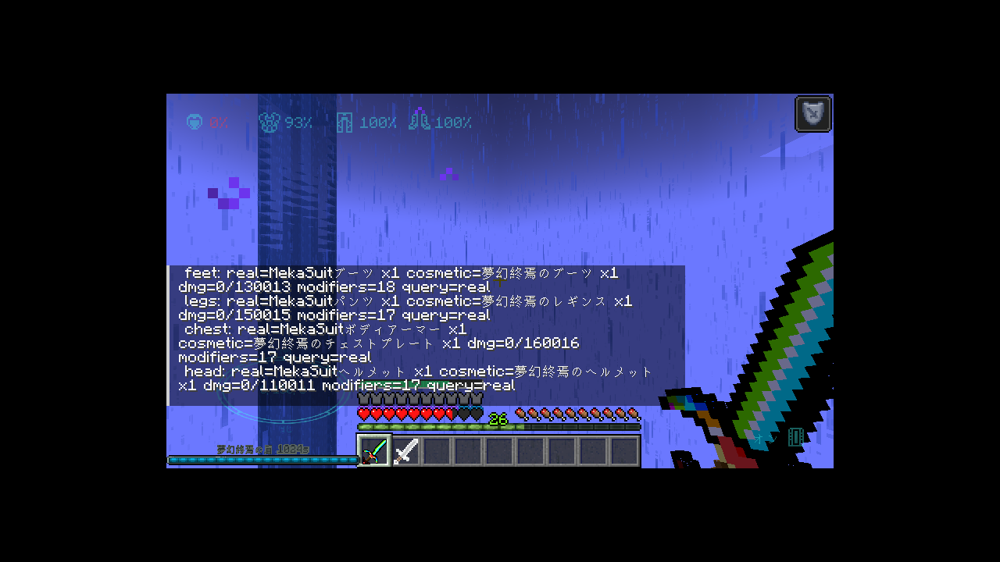
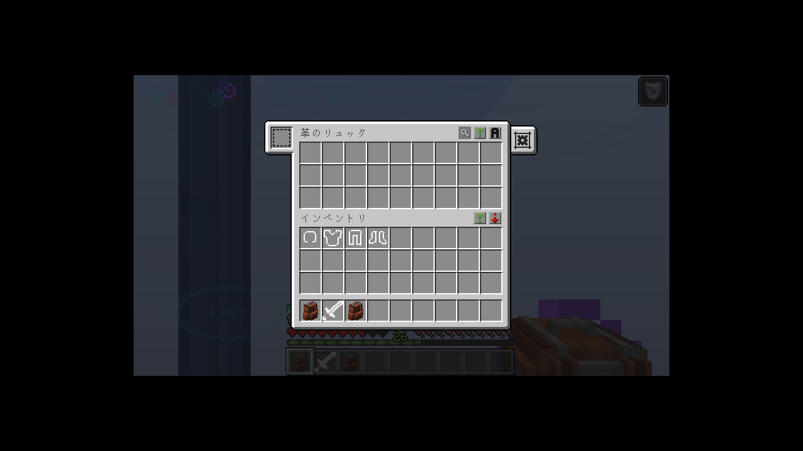
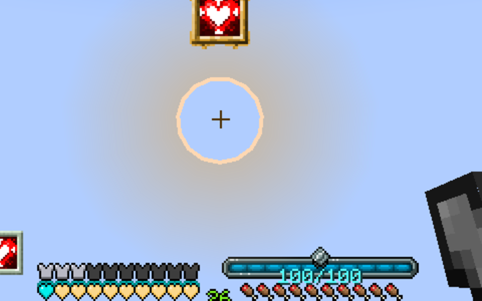

# Not Cosmetic Armor


[](https://www.minecraft.net/)
[](https://files.minecraftforge.net/)
[](https://adoptium.net/)
[](LICENSE)
[](https://github.com/code-onigiri/not-cosmetic-armor/actions/workflows/build.yml)
[](https://github.com/code-onigiri/not-cosmetic-armor/releases)

Cosmetic Armor Reworked のコスメ装備を、**見た目だけ**から**実際に機能する装備**に変える 1.20.1 Forge 用アドオンです。

> **English**: Makes the cosmetic slots of [Cosmetic Armor Reworked](https://www.curseforge.com/minecraft/mc-mods/cosmetic-armor-reworked)
> actually work — armor attributes, enchantments, item ticks, durability mirroring and movement
> sync (jetpacks fly). Requires CAR on both client and server. Grab the jar from
> [Releases](https://github.com/code-onigiri/not-cosmetic-armor/releases); the full English
> description is in [docs/publishing.md](docs/publishing.md).

コスメ枠に防具を入れると、その防具の防御力・防具強度・ノックバック耐性などの属性と、
Protection / Thorns / Frost Walker などのエンチャントが有効になります。
実装備（本物の防具枠）はそのまま「本物」として動き続けます。

## 動作環境

| 項目 | バージョン |
|---|---|
| Minecraft | 1.20.1 |
| Forge | 47.x（開発・検証は 47.4.28） |
| Java | 17 |
| 必須 | [Cosmetic Armor Reworked](https://www.curseforge.com/minecraft/mc-mods/cosmetic-armor-reworked) 4.x（1.20.1-v1a で検証） |

CAR は必須依存です（`mods.toml` で `mandatory=true`）。CAR が無い場合は Forge が
「Missing or unsupported mandatory dependencies」として起動を止めます。

## 導入

1. [Cosmetic Armor Reworked](https://www.curseforge.com/minecraft/mc-mods/cosmetic-armor-reworked)（1.20.1 版）を `mods/` に入れる。
2. 本 MOD の jar（`notcosmeticarmor-1.20.1-<version>.jar`）を `mods/` に入れる。[Releases](https://github.com/code-onigiri/not-cosmetic-armor/releases) から取得する。
3. クライアントとサーバーの**両方**に入れる（機能の判定はサーバー側で行い、描画は CAR が担当するため）。
4. サーバー側は `config/notcosmeticarmor-server.toml` が生成される。既定で有効。

導入できているかは `/notcosmeticarmor status`（権限レベル 2 以上）で確認できます。
`car: detected` と `mode=INTERLEAVE` が出ていれば正常です。

## 何が機能するか

- **属性**: コスメ防具の attribute modifier（防御力、防具強度、ノックバック耐性、移動速度など）を実装備の上に加算。UUID はプレイヤー・スロットごとに再生成するので、実装備の modifier と衝突しません。
- **エンチャント**: `Player#getItemBySlot` と `Player#getArmorSlots` の両方を上書きしてコスメ装備を「着ている防具」として返すため、バニラのダメージ軽減（Protection / Feather Falling / Thorns / Respiration）や他 MOD の参照にもコスメ防具が見えます。バニラの軽減計算は `getItemBySlot` ではなく `getArmorSlots` のリストを回すため、片方だけでは効きません。
  この上書きは**クライアント側でも**効きます（CAR の `CosArmorAPI.getCAStacksClient` からコスメを読む）。水中呼吸のようにクライアント側の判定も見る MOD や、クライアントで完結する表示にコスメ装備を反映させるためです。描画中だけは CAR の差し替えと二重にならないよう止めています（[描画（L4）](#描画l4)）。
  同じスロットの実装備のエンチャントとも**合算**されます（属性ミラーと同じ「両方足す」方針）。バニラの軽減は EPF の合計が 20 で頭打ちなので、二重に Protection IV を積んでも上限を超えません。
- **tick 内の参照（インタリーブ）**: 奇数ゲーム tick の `Player#tick` の間だけ、コスメ装備を実装備枠に**コピー**して入れ、tick の終わりに元へ戻します。鞘翅の滑翔判定、カメの甲羅の水中呼吸、MOD の「この装備を着ているか」判定など、tick の内側で `getItemBySlot` を読む処理にもコスメ装備が見えます。クライアントには何も送られず、実装備は一切失われません。
- **item tick**: コスメ枠のアイテムにも `inventoryTick` / Forge の `onArmorTick` が走ります。エネルギーやチャージを持つ MOD 防具（TiC など）の動作に必要です。**クライアント側でも**同じ tick を回すので、「tick の中でプレイヤーの能力を書き換える」MOD 防具（夢幻終焉チェストプレートの `mayfly`、など）もコスメ枠で機能します。
- **動き（jetpack など）**: コスメ装備の tick が `setDeltaMovement` で速度を変えたときは、その変化を `ClientboundSetEntityMotionPacket` で本人にも送り返します。プレイヤーの移動はクライアント権威（クライアントの自己予測が正）なので、これが無いとサーバー側だけで飛んでいる状態になり、画面では何も起きません。
- **耐久**: 実装備が耐久ダメージを受けたとき、同じスロットのコスメ装備にも**同じ量**のダメージが入ります（4 分の 1 丸め・最低 1 のバニラ規則、Unbreaking、壊れたら消える挙動まで同じ）。`/notcosmeticarmor status` の `dmg=` で両方の耐久値を確認できます。
- **セット判定（fantasy_ending / EndingLib）**: 4 点セットの判定を「実装備とコスメ枠の合算」に広げます。コスメ枠に別の防具を載せても、実装備の夢幻終焉 4 点セットは消えません（逆に、実装備 2 点 + コスメ 2 点でも 4 セットになります）。判定は EndingLib の `ArmorUtils#getArmorSet` 1 メソッドだけを上書きするので、他の MOD の判定には影響しません。
- **実装備優先（`behavior.realPriorityNamespaces`）**: Mekanism のように「メカスーツを着ている前提」で能力を判定する MOD では、コスメ枠に別の防具があるとメカスーツの効果（Step Assist・重力変調・静水学的反発ユニットなど）が止まります。そこで、既定で `mekanism` 名前空間の装備だけ、**同じスロットに実装備があれば実装備を返す**ようにしています。tick 窓でもそのスロットの実装備は退避しないので、半 tick おきに能力が消えることはありません。コスメ枠が空、または実装備がその MOD の装備でなければ従来どおりコスメが優先されます（一覧は設定で増減できます）。
- **相性の悪い MOD への小さなパッチ（同梱）**: `Inventory#armor` を直接読む MOD は、上の 4 層では拾えません。そういう MOD に限り、その MOD の判定メソッド 1 つにだけ注入して「実装備で見つからなければコスメ枠も見る」と広げます。対象 MOD が入っていなければ何も適用されません（現在は ProjectE と Sophisticated Backpacks。下記の[互換性](#互換性実機で確認した-mod)）。

## 何が機能しないか（意図的）

- **描画**: 見た目の差し替えは従来どおり CAR が担当します。本 MOD は描画コードに触りません（[描画（L4）](#描画l4)）。
- **実装備の tick**: コスメの下に隠れている実装備も、これまで通り tick されます（バニラの挙動を変えない方針）。
- **軽減の上限**: ダメージ軽減エンチャントはバニラの規則どおり EPF 合計 20（最大 80%）で頭打ちです。実装備とコスメで積んでも上限は変わりません。
- **jetpack の速度は加算されない**: jetpack の推力は 1 スタックぶんの `speedVert` で頭打ちになる仕様なので、実装備とコスメに 1 個ずつ入れても 2 倍にはなりません。クライアントは実装備しか見えないため、両方入れると**実装備側の速度**に引っ張られます（[検証ログ](#iron-jetpacks-の検証実機)）。
- **ピグリン**: `PiglinAi` が金防具を `getArmorSlots` で判定するため、コスメの金防具でもピグリンが敵対しなくなります（バニラの判定と同じ経路に乗るため、意図的に残しています）。

## 互換性（実機で確認した MOD）

| MOD | バージョン | 結果 |
|---|---|---|
| [Cosmetic Armor Reworked](https://www.curseforge.com/minecraft/mc-mods/cosmetic-armor-reworked) | 1.20.1-v1a | 必須。コスメ枠の保持と描画を担当 |
| [Tinkers' Construct](https://modrinth.com/mod/tinkers-construct) + Mantle | 3.12.1.231 / 2023.11.24 | コスメ枠の属性・耐久ミラーが動く（`ArmorItem` 系） |
| [Iron Jetpacks](https://modrinth.com/mod/iron-jetpacks) + Cucumber | 7.0.9 / 7.0.16 | コスメ枠で飛行する（速度は実装備側が優先） |
| [ManaitaMTK](https://modrinth.com/mod/manaitamtk) | 1.7.4 | コスメ枠でも「ダメージ 0・死亡しない」が成立 |
| [AdvancedAE](https://modrinth.com/mod/advanced-ae) | 1.3.6 | 量子ヘルメットの水中呼吸がコスメ枠で動く（アップグレード導入・電力供給が前提） |
| [ProjectE](https://modrinth.com/mod/projecte) | 1.20.1 | ジェム防具の満腹度回復・ダメージ軽減・**飛翔・Step Assist** がコスメ枠で動く（互換パッチ同梱） |
| [Mekanism](https://modrinth.com/mod/mekanism) | 10.4.16.80 | 実装備のメカスーツの効果（Step Assist・重力変調・静水学的反発・スキューバ）が動く。コスメ枠に夢幻終焉を着けてもメカスーツの判定は消えない（`behavior.realPriorityNamespaces`） |
| fantasy_ending（要 EndingLib） | 2.7.20 / 2.2.1fix | 夢幻終焉 4 点のセット効果（128 以下のダメージ無効化・シールド・死亡時復帰・効果無効）が動く。**実装備とコスメ枠の合算で判定**するので、実装備のセットがコスメに隠れない |
| [Sophisticated Backpacks](https://modrinth.com/mod/sophisticated-backpacks) + Sophisticated Core | 3.26.14.2226 / 1.5.15.2427 | コスメ枠（胸）のバックパックが **B キーで開き、中身を出し入れでき、背中に描画される**。同じスロットに実装備のバックパックがあればそちらが優先（互換パッチ同梱） |
| [Apotheosis](https://modrinth.com/mod/apotheosis) + Placebo + Apothic Attributes | 7.4.8 / 8.6.3 / 1.3.7 | コスメ枠の装備の**アフィックス属性**（最大体力・防御力・防具強度・呪文威力など）が実装備の上に加算される。ダメージ軽減系（`blockading` / `feathery` など）もコスメ枠で機能する（実機検証済み） |
| [Iron's Spellbooks](https://modrinth.com/mod/irons-spellbooks) | 3.16.3 | コスメ枠の装備の**アップグレードオーブ属性**（`irons_spellbooks:upgrade_data`）が加算される。装備に注入した呪文（`spell_container`）も `getItemBySlot` 経由で見え、スペルホイールへの表示と発動（V キー）まで動く（実機検証済み。実装備優先のスロットでは実装備が優先されるためコスメの呪文は使えない） |

バニラの `ArmorItem` の属性・耐久経路を使う防具なら、同じ経路に乗るので同様に動く見込みです。
独自の装備判定を持つ MOD は、その MOD が `getItemBySlot` / `getArmorSlots` を読むかどうかで
結果が変わります（[仕組み](#仕組み)）。`Inventory#armor` を直接読む MOD は、
そのリスト自体を書き換えない限りコスメ装備を見ません（ProjectE と Sophisticated Backpacks は同梱のパッチで対応しています）。

### コスメ枠では効かないもの（MOD 側の実装都合）

- **実装備優先の対象 MOD（既定は Mekanism）のコスメ装備**: 同じスロットにその MOD の実装備があると、
  判定は実装備側になります。たとえば実装備がメカスーツでコスメ枠にもメカスーツを入れた場合、
  MOD から見えるのは実装備だけです（バニラの属性・エンチャント・耐久は両方効きます）。
  対象は `behavior.realPriorityNamespaces` で増減できます。
- **`Inventory#armor` を直接読む MOD 全般**: 上書きできるのは `getItemBySlot` / `getArmorSlots`
  であって、インベントリの生リストそのものではありません。tick 窓（interleave）の中だけは
  `Inventory#armor` にコスメのコピーが入るので、tick 内で生リストを読む MOD はコスメを見ます。
  それ以外の場面で生リストを読む MOD はコスメを見ないので、必要なものには
  [互換パッチ](#projecte-の互換パッチ)を個別に用意しています。

### ProjectE の互換パッチ

ProjectE は飛翔と Step Assist を `PlayerHelper#checkArmorHotbarCurios`（`Inventory#armor` を
直接 stream する）で判定するため、コスメ枠のジェムアーマーでは効きませんでした。
本 MOD はこのメソッドの戻り値だけを「実装備で一致しなかった場合に `getItemBySlot` 経由で
コスメ枠も見る」と広げます。ProjectE が既に `true` を返した場合は何もしません。

- 攻撃能力（爆発・電撃）のゲートである `GemArmorBase#hasAnyPiece` にも同じ注入をしていますが、
  こちらは**実機未検証**です。
- 対象クラスが無い環境では mixin config を読み込みません（`ProjectEMixinPlugin`）。
- 無効にしたいときは `config/notcosmeticarmor-server.toml` の `compat.patchProjectE=false`。
- `/notcosmeticarmor status` の `projectE: patch=... calls=... hits=...` で、呼ばれた回数と
  一致した回数が分かります（`calls` が増え続け `hits` が 0 なら、コスメ防具が条件を満たしていません）。

### Sophisticated Backpacks の互換パッチ

バックパックは「胸スロットに着ける装備」ですが、SB は装着の判定を
`PlayerInventoryProvider` の
`"armor"` ハンドラで
`player.getInventory().armor.get(EquipmentSlot.CHEST.getIndex())`（＝インベントリの生リスト）から
直接読んでいます。そのためコスメ枠のバックパックは、開くキー（既定 B）を押しても見つからず、
無反応でした（描画もされません）。

`PlayerInventoryHandler#getStackInSlot` は
`runOnBackpacks`（キー・ボタン）、
`getBackpackFromRendered`（背中の描画）、
`BackpackContext$Item#getBackpackWrapper`（メニューの生成）の**3 経路すべてが通る 1 点**なので、
ここだけを差し替えています（`require = 0` なので、SB 側の実装が変わって注入点が消えても起動は壊れません）。

- 実装備の胸にバックパックがある場合は**実装備を優先**します（コスメのバックパックは開きません）。
- 対象クラスが無い環境では mixin config を読み込みません（`SophisticatedBackpacksMixinPlugin`）。
- 無効にしたいときは `config/notcosmeticarmor-server.toml` の `compat.patchSophisticatedBackpacks=false`。
- `/notcosmeticarmor status` の `sophisticatedBackpacks: patch=... calls=... hits=...` で、
  呼ばれた回数とコスメ側を返した回数が分かります（実装備のバックパックがある間は `calls` だけが増えます）。

### 本 MOD が原因ではない起動クラッシュ（実機で切り分け済み）

- **Re-Avaritia 1.4.2 + irons_lib 2.2.0**: 両者が `LocalPlayerMixin` の同じメソッドに
  `@Redirect` を当てており、`Critical injection failure: Redirector avaritia$shieldDoesNotSlowMovement ... (0/1) succeeded`
  で起動が止まります。本 MOD と CAR を外しても同じように落ちることを確認しました。
- **fantasy_ending 2.7.20**（EndingLib が無い場合）: `com.mega.endinglib.util.mc.entity.armor.ArmorUtils` が
  見つからず `ClassMetadataNotFoundException`。EndingLib は別途必要な依存で、jar には含まれていません。
  EndingLib を入れた構成では起動し、夢幻終焉セットの防護がコスメ枠で動くことを実機で確認済みです（下の検証ログ）。

## 設定

`config/notcosmeticarmor-server.toml`（サーバー側）:

| キー | 既定 | 説明 |
|---|---|---|
| `general.enabled` | true | MOD 全体の有効/無効 |
| `behavior.mirrorAttributes` | true | コスメ防具の属性を実装備に加算する |
| `behavior.overrideQueries` | true | `getItemBySlot` / `getArmorSlots` でコスメ防具を返す（エンチャント有効化） |
| `behavior.interleave` | true | 奇数 tick の間だけコスメ装備を実装備枠にコピーする（tick 内参照の有効化） |
| `behavior.tickCosmeticItems` | true | コスメ枠のアイテムを tick する |
| `behavior.cosmeticDurability` | true | 実装備が受けた耐久ダメージをコスメ装備にも同じ量だけ入れる |
| `behavior.ignoreSkinArmorFlag` | true | CAR の「skin armor」フラグが立ったスロットも機能させる |
| `behavior.realPriorityNamespaces` | `["mekanism"]` | この名前空間の装備は、同じスロットに実装備があれば実装備を優先する（MekaSuit 用）。カンマ区切りのリスト |
| `compat.patchProjectE` | true | ProjectE の飛翔・Step Assist 判定にコスメ枠を足す（ProjectE 導入時のみ意味を持つ） |
| `compat.patchSophisticatedBackpacks` | true | Sophisticated Backpacks のバックパック探索にコスメ枠を足す（SB 導入時のみ意味を持つ） |

## コマンド

```
/notcosmeticarmor status   # 状態表示
/notcosmeticarmor probe    # tick 窓の内外で getItemBySlot が何を返すかをログに出す（デバッグ）
/notcosmeticarmor cosmetic <feet|legs|chest|head> <item id|none|hand>   # コスメ枠に直接入れる（検証用）
```

権限レベル 2 以上。`status` は CAR の検出状況、実効モード（OFF / ATTRIBUTE / PRIORITY / INTERLEAVE）、
設定値、各スロットの実装備/コスメ装備、適用中の modifier 数、現在の防御力、差分ガードと tick 窓の
状態を表示します。`cosmetic` はワールドを出ずにコスメ枠の組み合わせを変えるためのコマンドです
（`/notcosmeticarmor cosmetic chest fantasy_ending:fantasy_ending_chestplate` のように使います。
CAR のインベントリ経由で書くので、通常の編集と同じように同期・保存されます）。
アイテムを手に持っている場合は `hand` を渡すと、**NBT ごと**コピーしてコスメ枠に入ります
（Apotheosis のアフィックス、Iron's Spellbooks の注入呪文やアップグレードオーブ、Mekanism の
モジュールのように、振る舞いが NBT にある装備を試すための近道です）。
`probe` を有効にすると、数秒おきに次のようなログが出ます:

```
probe(inside window): chest seen=1 golden_chestplate storedReal=1 diamond_chestplate armorValue=13
probe(outside window): chest seen=1 diamond_chestplate armorValue=13
```

## ビルド

Nix を使う場合（JDK 17 とクライアント実行用ライブラリが揃います）:

```sh
nix develop
./gradlew build
# => build/libs/notcosmeticarmor-1.20.1-<version>.jar
```

Nix を使わない場合は JDK 17 を用意して `./gradlew build` を実行してください
（Gradle 8.8 は wrapper が取得します）。

開発用クライアント:

```sh
./gradlew runClient
```

CAR は CurseMaven 経由の依存として `build.gradle` に入っているので、`runClient` でも
そのまま読み込まれます（`fg.deobf` が SRG 名の配布 jar を開発用の名前に変換します）。
`run/mods/` に CAR の配布 jar を直接置かないでください。SRG 名のままでは開発ランタイムで
`Component.m_237113_` が見つからず、起動時に `NoSuchMethodError` で落ちます。

```groovy
implementation fg.deobf('curse.maven:cosmetic-armor-reworked-237307:4600191')
```

バージョンを変えるときは CurseForge のファイル ID（末尾の数字）を差し替えてください。

`compileJava` は Gradle のビルドキャッシュを使わない設定にしてあります。mixin の refmap は
アノテーションプロセッサが `build/tmp` に書き出すため、キャッシュから復元されると jar に
入らないことがあるからです。refmap が無いと本番で `No refMap loaded` になり全 mixin が
失敗します。`jar` タスクは refmap の同梱を検証し、無ければビルドを失敗させます。

## 仕組み

1. **属性ミラー** — 毎 tick、コスメ枠の `getAttributeModifiers` を読み、UUID を再生成した
   transient modifier として `AttributeMap` に追加/削除する。クエリ上書きとは独立に動く。
2. **クエリ上書き** — `Player#getItemBySlot` の RETURN で、防具スロットかつサーバー側のときだけ
   コスメスタックを返す。`Player#getArmorSlots`（`m_6168_`。バニラのダメージ軽減が回すリスト）も
   同じ条件で、実装備リストをコピーしてコスメに差し替えたリストを返す。実体（`Inventory#armor`）は
   一切書き換えない。ただし「実装備優先」の対象 MOD（既定は Mekanism）の装備が実装備枠にある
   スロットだけは、その実装備をそのまま返す。
3. **差分ガード** — バニラは `LivingEntity#tick` の中で毎 tick 装備の差分を取り、
   変化があれば属性を付け替えて `ClientboundSetEquipmentPacket` を送る。その差分処理の間だけ
   上書きを止め、バニラには常に実装備を見せる。これがないと毎 tick パケットが飛び、属性が壊れる。
4. **tick 窓（インタリーブ）** — 奇数 tick の `Player#tick` の間だけ、コスメの**コピー**を
   `Inventory#armor` に入れて実装備を退避する。窓の中ではバニラの装備差分処理自体を
   `detectEquipmentUpdates` の HEAD でキャンセルするので、属性の二重計上もパケット送信も起きない。
   窓は tick の終わり（例外時は次 tick の頭）に必ず閉じ、実装備を書き戻す。
   コピーを入れているので、`Inventory#armor` を直接書き換える他 MOD は窓の中ではコピーを見る。
5. **耐久ミラー** — 実装備が耐久ダメージを受ける経路（`Player#hurtArmor`）に注入し、同じ量を
   コスメ装備にも与えて CAR に書き戻す。窓が開いている間は一旦閉じて実装備を戻してから
   バニラに処理させるので、実装備の耐久値が捨てられることはない。コスメが壊れたらスロットは空になり、
   属性もその場で消える（防御力 13 → 8 に戻る）。

モードは設定の組み合わせで決まります: `enabled=false` が OFF、`mirrorAttributes` のみで ATTRIBUTE、
`+overrideQueries` で PRIORITY、`+interleave` で INTERLEAVE（既定）。

設計検討の詳細は [docs/plan-review.md](docs/plan-review.md)、公開手順と掲載文は
[docs/publishing.md](docs/publishing.md)、変更履歴は [CHANGELOG.md](CHANGELOG.md) を参照。

## 描画（L4）

見た目の差し替えは CAR の担当です。本 MOD は描画コードを持たず、防具モデルも描きません。

CAR は `RenderPlayerEvent.Pre`（優先度 HIGH）でクライアントの `Inventory#armor` をコスメに
入れ替え、`Post`（優先度 LOW）で元に戻します。入れ替え元は CAR 自身のインベントリ
（`InventoryCosArmor`）で、`getItemBySlot` は経由しません。

クライアント側のクエリ上書きを入れたことで、この入れ替えの窓の中では本 MOD の上書きが
コスメを二重に返してしまいます。そこで `ClientRenderGuard` が
`RenderPlayerEvent.Pre`（優先度 LOWEST、= CAR の入れ替えより後）から
`Post`（優先度 LOWEST、= CAR の復元より後）までの間だけ上書きを止めます
（`QueryGuard`）。結果として描画パスの間は CAR の入れ替えだけが見え、二重描画も
「コスメを消す」ような取りこぼしも起きません。Pre がキャンセルされた場合は Post が
来ないので、その場でフラグを戻します。

二重描画を止めるための `HumanoidArmorLayer#renderArmorPiece` の mixin（計画書の M11）は
不要と判断し、入れていません。

実機での確認（同じ視点で連続キャプチャし、ピクセル比較）:

| 見る場所 | 結果 |
|---|---|
| HUD の防具バー | 12 フレームすべてピクセル一致（8 と 13 の間でチカチカしない） |
| インベントリの防具スロット | 8 フレームすべてピクセル一致（ダイヤのまま。コスメが漏れていない） |
| 三人称のモデル | 常に金胸当て（実装備のダイヤと二重に描かれない） |


インベントリの防具スロットは実装備（ダイヤ）、中央のモデルはコスメ（金）。層が分かれているのが
そのまま見えます。防具バーの 13 は実装備 8 + コスメ 5 です。

## 検証ログ（実機）

1.20.1 Forge 47.4.28 + CAR 1.20.1-v1a、実装備にダイヤ胸当て・コスメ枠に金胸当て:


armor は 8 + 5 = 13、窓の内外で `getItemBySlot` が入れ替わり、防御力は 13 のまま（二重計上なし）。

耐久のミラー（実装備ダイヤ 528 / コスメ金 112）:


| 与えたダメージ | 実装備 | コスメ |
|---|---|---|
| `/damage @p 5 minecraft:mob_attack` | 1/528 | 1/112 |
| 炎の上に 3 秒（`in_fire` 1.0 × 8） | 18/528 | 18/112 |
| 同上のあと 1 回 mob_attack（コスメは 111 から） | 19/528 | 破壊されてスロットが空、防御力 13 → 8 |

`/damage @p 5`（既定の `minecraft:generic`）では耐久は減りません。これはバニラの仕様で、
`bypasses_armor` タグの付いたダメージは防具の耐久を削らないためです。耐久のテストには
`minecraft:mob_attack` か炎を使ってください。

### エンチャントの検証（実機）

体力 200・難易度 hard・自然回復オフ（`/gamerule naturalRegeneration false`）で、
`/damage` と `/data get entity @p Health` の差分から実測しました。実装備はダイヤ胸当て
（防御力 8・強度 2）、コスメは TiC 銅プレート胸当て（防御力 3）・Protection IV 金ヘルメット・
Feather Falling IV 金ブーツ（合計防御力 14）。

| 条件 | ダメージ | 実測 | 計算 |
|---|---|---|---|
| コスメ無し（実装備のみ、防御力 8） | `mob_attack` 10 | 8.4 | 強度込みの式で 8.4 |
| Protection IV コスメ、`getArmorSlots` 上書き**前**（防御力 14） | `mob_attack` 10 | 6.0 | 装甲のみ 10 × (1 − 10/25) = 6.0（EPF が乗らない） |
| 同上、上書き**後**（置き換え） | `mob_attack` 10 | 5.04 | 6.0 × 0.84 |
| 実装備 FF IV 金ブーツ + コスメ FF IV 金ブーツ + コスメ Prot IV 金ヘルメット（**合算**、防御力 15） | `mob_attack` 20 | 12.096 | 装甲 14.4 × (1 − 4/25) |
| 同上 | `fall` 20 | 4.0 | EPF 28 → 上限 20 → 20 × 0.2 |

上書き前は Protection IV が完全に無効、上書き後（コスメのみ）は 5.04、実装備とコスメを合算する
現在の実装では実装備の Feather Falling IV とコスメの FF IV / Protection IV がすべて加算され、
EPF 28 → 上限 20 の 4.0 になります。

TiC 防具（`tconstruct:plate_chestplate`、`ArmorItem` 系）も属性ミラー・耐久ミラーが
そのまま動き、モブ攻撃 3 回で実装備 22→28/528、コスメ 0→6/208 と同量ずつ減りました。

### 水中呼吸（Respiration）の検証（実機）

コスメ枠に Respiration III の金ヘルメットだけを入れて（実装備は空）、水柱の中で泡の数を数えました。
**泡の数は `SynchedEntityData` で同期されるサーバー値の表示**なので、泡を見ればサーバー側の
エンチャント判定をそのまま測れます（`/data get entity @p Air` をチャット越しに読むと往復に
数十秒かかり、前回はそれを経過時間と取り違えて「効いていない」と誤読しました）。

1. `/gamemode creative` → 水面より上で Air を 300 まで回復。
2. `/fill -2 90 -2 2 105 2 minecraft:water` で水柱を作る。
3. `/gamemode survival` にして水柱の中へ移動し、13 秒後に撮影。

結果は**泡 7 個（Air 210〜240）・ハート満タン**。Respiration III の期待損失は
260 tick × 0.25 = 65 なので 8 個弱で、観測と一致します。エンチャント無しなら 13 秒で
1 個以下＋溺死ダメージになるため、**コスメ枠の Respiration は正しく効いています**。

### AdvancedAE 量子ヘルメットの水中呼吸（実機）

[AdvancedAE](https://modrinth.com/mod/advanced-ae) 1.3.6 の量子ヘルメット（`advanced_ae:quantum_helmet`）に
`water_breathing_tag:{enabled:1b}` と `internalCurrentPower` / `internalMaxPower` を入れたものを
コスメ枠の HEAD に置き、同じ水柱で 21 秒間過ごしました。**泡は 10 個のまま減りません**。

AdvancedAE の判定は `AAELivingEntityEvents#breath` が `player.getItemBySlot(HEAD)` を見て
`LivingBreatheEvent#setCanBreathe` を立てる経路なので、本 MOD のクエリ上書きにそのまま乗ります。
効かない場合は (1) ヘルメットに水中呼吸アップグレードが入っていない、
(2) アップグレードが `enabled` になっていない、(3) 電力がコスト未満、のいずれかです
（`isUpgradePowered` は `ForgeCapabilities.ENERGY` の残量が `UpgradeType#getCost` 以上かを要求します）。

### 他 MOD の「装備判定」との連携（まな板MTK）

[ManaitaMTK](https://modrinth.com/mod/manaitamtk) 1.7.4 の「まな板のヘルメット」を**コスメ枠**に
入れて検証しました（実装備の HEAD は空、インベントリにもまな板ヘルメットは無し）。

| 試験 | 参考（まな板以外のコスメでの実測） | コスメ枠にまな板ヘルメット |
|---|---|---|
| `/damage @p 20 minecraft:fall`（装甲を貫通） | 7.2（FF IV 金ブーツ） | **0**（Health 200 のまま） |
| `/damage @p 20 minecraft:mob_attack` | 12.096（装甲 15 のとき） | **0** |
| `/damage @p 1000000 minecraft:mob_attack` | — | **0** |
| `/damage @p 20 minecraft:out_of_world` | — | **0** |
| `/kill @p` | — | **生存**（Health 200、死亡画面なし） |

チャットには `Killed TestPlayer` と出ますが、Health は 200 のままでした。
副作用として、まな板ヘルメットの能力（暗視・透明化・移動速度・飛行の許可）もコスメ枠で有効に
なっています（`abilities.mayfly=1b`、`invisibility`/`night_vision` 400 tick を確認）。

**なぜ効くのか**: ManaitaMTK のヘルメットは自身の `inventoryTick` で
「HEAD スロットのアイテム（`getItemBySlot`）がまな板ヘルメットか」を見て、ItemStack の
`IInvincible` capability を立てます。ダメージ・死はその capability を見た Forge イベント
（`LivingAttackEvent` / `LivingHurtEvent` / `LivingDamageEvent` / `LivingDeathEvent`）で
キャンセルされます。本 MOD は (1) コスメ枠のアイテムにも `inventoryTick` を回し、
(2) `getItemBySlot` がコスメを返すため、この経路にそのまま乗ります。MOD 側の変更は不要でした。

まな板装備の属性はバニラの上限で頭打ちになるため（armor は 30、強度も上限あり）、
「装甲で耐える」のではなく「イベントがキャンセルされて 0 ダメージ」になっている点が重要です。

### Iron Jetpacks の検証（実機）

[Iron Jetpacks](https://modrinth.com/mod/iron-jetpacks) 7.0.9 + Cucumber 7.0.16。コスメ枠に
jetpack を 1 個だけ入れて、スペースで上昇させながら F3 の Y を 2.3〜2.8 秒間隔で 2 点読みました。

| 構成 | 上昇速度 | blocks/tick | 理論値 |
|---|---|---|---|
| コスメ iron | 7.63 b/s | 0.38 | 0.41 |
| コスメ gold | 11.34 b/s | 0.57 | 0.61 |
| 実 iron + コスメ gold | 8.15 b/s | 0.41 | 実 iron の 0.41 |
| 実 gold + コスメ iron | 11.15 b/s | 0.56 | 実 gold の 0.61 |
| 実 gold + コスメ gold | 12.17 b/s | 0.61 | 0.61 |

スクショ取得の ~0.15 s ぶん実測は理論値の約 0.93 倍に出ますが、iron : gold の比 1.49 は
`0.61 / 0.41 = 1.49` と一致します。**コスメ枠の jetpack は単体で正しく飛びます**。

2 個入れた場合（表の 3〜5 行）は加算されず、**実装備側の速度**になります。jetpack の推力は
`min(motionY + accel, speedVert)` を装備 1 個ぶんから決めるため、そもそも 2 個で 2 倍には
ならない仕様です。サーバー側で「装備中」として動くのはコスメ枠の 1 個だけなので、実装備側の
jetpack は燃料を消費しません（クライアント側の表示だけ減ります）。

最初は飛びませんでした（Y が 95.9 → 96.3 → 96.1 で、エネルギーだけ 800000 → 789320 に減る）。
原因と修正は [docs/plan-review.md](docs/plan-review.md) の §14 に書いています。

### ProjectE ジェム防具の検証（実機）

[ProjectE](https://modrinth.com/mod/projecte) 1.20.1 のジェムのブーツ（`projecte:gem_boots`）を
コスメ枠の FEET、ジェムの鎧（`projecte:gem_chestplate`）を CHEST に入れ、実装備は空にして検証しました。

| 見たもの | 結果 |
|---|---|
| `/notcosmeticarmor status` の `projectE:` | `patch=true calls=4106 hits=4106`（呼ばれた回数と一致した回数が同じ） |
| `forge:step_height_addition` | `1.0`（基準 0.6 + Step Assist 0.4 ADDITION） |
| `abilities.mayfly`（サバイバル） | `1b` |
| ジャンプ 2 回（80 ms 押下 → 160 ms → 80 ms）+ 2 秒ホールド | 飛翔開始。`Pos[1]` が 95.0 → 173.4 まで上昇 |
| `/gamemode creative` → `/gamemode survival` の往復 | `mayfly=1b` のまま。往復後もダブルタップで飛翔できる |

パッチ前は `calls` が増えても `hits` が 0 で、`mayfly` は 0b、`step_height_addition` も
0.6 のままでした。原因は 2 つあり、どちらも [docs/plan-review.md](docs/plan-review.md) の §16 に
書いています（判定が `Inventory#armor` の直読み / `InternalAbilities` のキャッシュが
ゲームモード変更で固まる）。

飛翔の開始は**ジャンプのダブルタップ**である点に注意してください。キー入力の押下が短すぎると
（12 ms 程度）クライアントの入力サンプリングに拾われず、2 回目の押下が「押しっぱなしの継続」と
判定されて飛びません。

### fantasy_ending（夢幻終焉セット）の検証（実機）

fantasy_ending 2.7.20 + EndingLibraryTweaked 2.2.1fix。夢幻終焉の 4 点（ヘルメット・チェストプレート・
レギンス・ブーツ）を**コスメ枠だけ**に入れ、実装備は空にしました。

| 見たもの | 結果 |
|---|---|
| `/notcosmeticarmor status` | `armor=70`（15+18+20+17 の属性ミラー） |
| 4 セット判定（サーバー / クライアント） | `is4=true` / シールド HUD のバーが表示される |
| シールドのケイパビリティ | `level=4936 dr=128.0` |
| `/damage @p 50 minecraft:mob_attack` | 無効（HP 547.5 → 547.5） |
| `/damage @p 150 minecraft:mob_attack` | 通る（HP 547.5 → 545.4） |
| ヘルメットを抜いて 3 点にした対照 | `is4=false` / `shield[level=0]` / `armor=53`、同じ 50 が 9.8 通る |

fantasy_ending の装備判定（`ArmorUtils#getArmorSet`）は `getItemBySlot` を 4 回呼ぶだけなので、
パッチ無しでそのまま動きます。**「効かない」と感じるときは次の 3 つを疑ってください。**

- ダメージが 128 を超えている（仕様上、128 以下しか無効化しません。超過分は 128 を引いて 0.75 倍）
- 4 点が同じ素材で揃っていない（1 枚でも別素材だとセットになりません）
- 古い jar（0.1.0 など 1.1.0 未満）を使っている（サーバー側の防護は効きますが、クライアント側の
  セット判定が false になり、シールド HUD が出ません）

なお、夢幻終焉の次元（`fantasy_ending:faded_void`）では**セットを着ていなくても**小さいダメージが
無効化されるため、検証は通常世界（overworld）で行う必要があります。

### コスメ装備が実装備のセット判定を隠す件（実機、1.4.0）

「コスメに何か入れると、実装備のセット能力（飛行・kill 無効化）が消える」という報告を
上の構成で再現しました。1.3.0 では次の 2 つが原因でした。

| ケース | 実装備 | コスメ枠 | 1.3.0 | 1.4.0 |
|---|---|---|---|---|
| A | 夢幻終焉 4 点 | ダイヤ 4 点 | `set=DIAMOND is4=false shield[level=0]`、`/kill` で死亡、HUD バー無し | `set=FANTASY_ENDING_MATERIAL is4=true shield[level=4936]`、`/kill` で死亡しない、`/damage 50` 無効、`/damage 200` は通る、毒は拒否、HUD バー表示、飛行可（Y 173.4 → 188.7 / 2 秒） |
| B | 空 | 夢幻終焉 4 点 | 動作（`is4=true` / シールド 4936） | 同じ（回帰なし） |

- 原因 1: EndingLib の `ArmorUtils#getArmorSet` は `getItemBySlot` を 4 回読むだけなので、
  コスメがあるスロットでは実装備が見えない（→ `ArmorSetUnion` で両方を見る）。
- 原因 2: コスメ枠の item tick がサーバー専用で、`abilities.mayfly` がクライアントに立たない
  （→ クライアント側でも item tick を回す）。
- 原因 3（原因 1 の修正後も残った）: tick 窓の中では実装備が `CosmeticState#windowReal` に
  退避されるため、窓の中だけ実装備セットが消える。シールドのレベルが半 tick おきに 0 へ
  リセットされ、HUD バーが出なかった（→ `ArmorSetUnion` が退避中のスタックも見る）。

### Mekanism メカスーツ + コスメ夢幻終焉（実機、1.5.0）

「実装備にメカスーツ（重力変調入り）、コスメ枠に夢幻終焉を 4 点」という構成で、
どちらの能力も同時に成立することを確認しました（実インスタンスのコピー、Mekanism 10.4.16.80）。

| 見た項目 | 1.4.0（修正前） | 1.5.0（修正後） |
|---|---|---|
| `forge:step_height_addition` | 0.6（Step Assist が出ない） | **1.1**（= 0.6 + Step Assist LOW 0.5） |
| `abilities.mayfly`（重力変調） | 0b | **1b**（ダブルタップで `abilities.flying` = 1b、Y 201.6 → 216.6 / 2 秒） |
| `forge:swim_speed`（静水学的反発、水中） | 1.0 | **2.0**（水中の上昇も 5.7 → 6.8 ブロック / 2 秒） |
| 夢幻終焉のセット | `is4=false shield[level=0]`、HUD のバー無し | **is4=true shield[level=4936]**、HUD のバー表示 |
| `/notcosmeticarmor status` | 4 スロットとも `query=cosmetic` | 4 スロットとも **`query=real`**（メカスーツの判定は実装備側） |

回帰（実装備が空、または実装備が優先対象でない場合）:

| 構成 | 結果 |
|---|---|
| 実装備=空 / コスメ=夢幻終焉 4 点 | `query=cosmetic`、`is4=true shield[level=4936]`、`mayfly=1b`、飛行 Y 230.7 → 245.7 / 2 秒（回帰なし） |
| 実装備=ダイヤ胸当て / コスメ=夢幻終焉 4 点 | そのスロットは `query=cosmetic`（従来どおりコスメが優先）。優先されるのは `behavior.realPriorityNamespaces` の名前空間だけ |

メカスーツ側の条件（Mekanism のソースで確認）: 静水学的反発ユニットは
`ModuleHydrostaticRepulsorUnit#isSwimBoost` が **4 個積み（`getInstalledCount() >= 4`）・`swim_boost` 有効・水中・電力あり**を要求します。1 個だけでは効果が出ないのは MOD の仕様です。
重力変調は 1000 J/tick、静水学的反発は 500 J/tick を消費します（既定値）。


### コスメ枠のバックパック・アフィックス・呪文オーブ（実機、1.6.0）

実インスタンスのコピー（Forge 47.4.28、Mekanism のメカスーツ 4 点を実装備、夢幻終焉 4 点を
コスメ枠、という構成のまま）で、追加の 3 MOD を検証しました。

**Sophisticated Backpacks 3.26.14.2226**:

| 操作 | 結果 |
|---|---|
| コスメ枠（胸）に革のバックパック → B キー | 「革のリュック」が開く（`calls=1273 hits=1219`） |
| shift+クリックで剣を収納 → 閉じて再度 B | 中身が残っている |
| 実装備の胸にダイヤのバックパックを追加 | 開くのは**実装備**（「ダイヤモンドのリュック」）。`calls` は増えるが `hits` は 1233 のまま |
| コスメ枠のバックパックを三人称で見る | 背中に描画される |



**Apotheosis 7.4.8**: ダイヤのチェストプレートを `/apoth lootify apotheosis:mythic` で
アフィックス付きにしてコスメ枠へ（`/notcosmeticarmor cosmetic chest hand`）。

| 属性 | コスメ有り | コスメ無し | 差 |
|---|---|---|---|
| 防御力 | 78.0 | 70.0 | +8（アフィックス + ダイヤ胸の基礎値） |
| 防具強度 | 44.0 | 42.0 | +2 |
| 最大体力 | 248.05 | 237.80 | +10.25（祝福のアフィックス） |
| `irons_spellbooks:spell_power` | 1.70 | 1.60 | +0.10（魔力が集まるアフィックス） |

**Iron's Spellbooks 3.16.3**: ダイヤのチェストプレートに
`irons_spellbooks:upgrade_data={slot:"chest",upgrades:{"irons_spellbooks:fire_power":2}}` を入れて
コスメ枠へ（`/item replace entity @p hotbar.0 ...` → `/data modify entity @p Inventory[{Slot:0b}]...`）。

| 属性 | 結果 |
|---|---|
| `irons_spellbooks:fire_spell_power` | 1.0 → **1.1**（0.05 × 2、MULTIPLY_BASE） |
| `/notcosmeticarmor status` | `modifiers=3 fromItem=3`、`nbt=[Damage, irons_spellbooks:upgrade_data]` |

どちらも属性の元は Forge の `ItemAttributeModifierEvent` です。本 MOD の属性ミラーは
`cosmetic.getAttributeModifiers(slot)` を呼ぶだけなので、このイベントに乗る MOD の動的な属性は
そのまま拾えます（`ItemStack#getAttributeModifiers` が `ForgeHooks.getAttributeModifiers` を呼ぶため）。

### 挙動系アフィックスと注入呪文の「発動」（実機、1.6.1）

属性にならないアフィックスと、装備に注入した呪文が**実際に発動するか**まで確認しました。

Apotheosis 7.4.8（rarity = `apotheosis:ancient`、`/apoth affix apply ... 1.0`）。ダメージはすべて同一条件（`/difficulty hard`、`naturalRegeneration false`、最大体力 200）での比較です。

| アフィックス | 入れた先 | ダメージ源 | 実ダメージ |
|---|---|---|---|
| （無し・鉄のチェストプレート） | コスメ胸 | `/damage @p 100 minecraft:mob_attack` | 64.66 |
| `apotheosis:armor/dmg_reduction/blockading` | コスメ胸 | `mob_attack 100` | **50.0**（-22.7%） |
| （無し・鉄のブーツ） | コスメ足 | `/damage @p 40 minecraft:fall` | 30.0 |
| `apotheosis:armor/dmg_reduction/feathery` | コスメ足 | `fall 40` | **18.0**（-40%） |
| `apotheosis:armor/dmg_reduction/feathery` | **実装備**の足（回帰） | `fall 40` | **18.0**（コスメと同一） |

挙動系アフィックスは `AdventureEvents#onDamage` が `entity.getAllSlots()`（= 手 + `getArmorSlots`）を回して適用します。本 MOD の `getArmorSlots` はコスメを `append` するので、属性にならない効果もコスメ枠から乗ります。

Iron's Spellbooks 3.16.3（鉄のチェストプレートに `irons_spellbooks:spell_container` で `irons_spellbooks:heal` level 1 を注入）:

| 構成 | R キー（ホイール） | V キー（発動） |
|---|---|---|
| コスメ胸のみ・両手空 | **Heal レベル1 / 回復量 5 / マナ 30 / クールダウン 15 秒** が出る | HP 140 → **145**、マナ 100 → **70** |
| 呪文がどこにも無い（対照） | 空 | HP 150 → **150**（変化なし） |
| 実装備=MekaSuit（`query=real`） | 出ない | HP 140 → **140**（発動しない） |
| 実装備=ダイヤ胸当て（`query=cosmetic`） | 出る | HP 140 → **145**（発動） |



注入呪文は `SpellSelectionManager` が `player.getItemBySlot(...)` で装備を読むため、コスメ枠の呪文もホイールに載り、サーバー側の詠唱も同じ経路で通ります。実装備優先（`behavior.realPriorityNamespaces`）のスロットでは `getItemBySlot` が実装備を返すので、そのスロットのコスメの呪文は使えません（意図どおり）。

計測時の注意:

- `/notcosmeticarmor cosmetic <slot> hand` は**メインハンドを空にしません**。そのまま測ると同じアイテムが手のスロットでも `getAllSlots()` に入り、アフィックスや呪文が二重に効きます（`blockading` を手に残したまま測ると 100 ダメージが 38.4、手を空にすると 50.0 でした）。
- この検証環境では、全スロットが空でもダメージに一律 ×0.75 の軽減がかかります（原因は未特定）。上の表はすべて同一条件内の比較です。

## 謝辞

- [Cosmetic Armor Reworked](https://www.curseforge.com/minecraft/mc-mods/cosmetic-armor-reworked)（zlainsama / original by dmillerw）— コスメ枠のインベントリと描画。
- Forge / Mixin / ForgeGradle の開発陣。

## ライセンス

MIT（[LICENSE](LICENSE)）。Cosmetic Armor Reworked 本体は MMPL 1.0.1 で、本 MOD は同 MOD を
再配布せず依存としてのみ参照します。

不具合報告・要望は [Issues](https://github.com/code-onigiri/not-cosmetic-armor/issues) へ。
